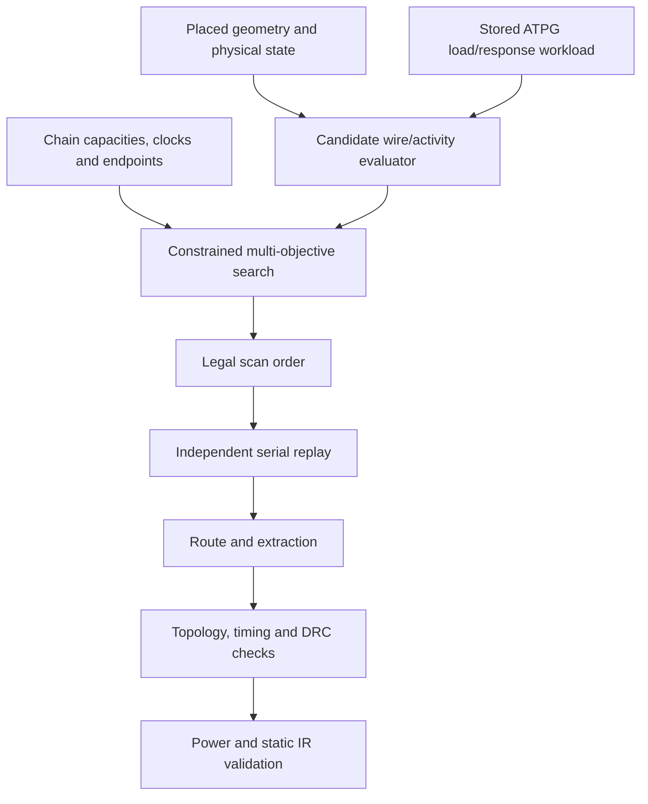
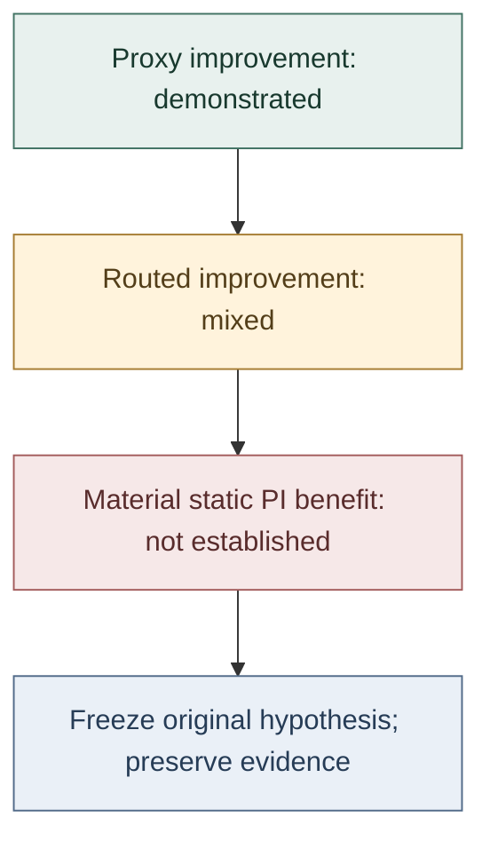

# PACT

### Physical and ATPG-aware Co-optimization of Test Architectures

PACT investigates whether scan-chain order can be optimized using placed geometry and ATPG switching behavior—and whether those gains survive routing and produce meaningful physical benefit.

> **Research status: FROZEN · Final validation: no material static power-integrity benefit**
>
> PACT demonstrated legal physical/activity-aware scan-order optimization and routed implementation. Its final registered study found no material static IR-drop improvement under the tested conditions. Development under that hypothesis was frozen; the implementation, measurements and negative result remain available for inspection.

[](pyproject.toml)
[](docs/upstream.md)
[](docs/methodology/atpg.md)
[](LICENSE)

[Methodology](docs/methodology.md) · [Exact evidence](docs/reproduction/canonical_results.md) · [Negative result](docs/experiments/negative_results.md) · [Run locally](#reproduction) · [Documentation](docs/README.md)

## PACT in 30 seconds

Scan construction commonly addresses legality, chain balance and geometry. ATPG patterns determine what switches during scan shift; placement determines the loads and locations of that switching. PACT asked: **can both sources of information guide a better legal scan order?**

It searches permutations using separate wire/activity objectives, preserves chain/test constraints, and checks selected orders through independent serial replay, routing, extraction and physical qualification. Wire and activity tradeoffs were measurable. Routed transfer was mixed. Static power-integrity effects were below the registered materiality threshold, so the original line of development stopped.

**Try the numerical portion:** install `.[optimizer,dev]`, then run `pact-optimize --synthetic 64 --chains 2 --time-budget 1 --output scratch/example`. No EDA stack is required; this does not reproduce the physical study. [Instructions](#level-1--lightweight-numerical-example).

## What happened?

| Scientific stage | Question | Outcome and exact evidence |
|---|---|---|
| Correctness | Can legal orders be evaluated consistently? | **✓ Qualified contracts:** reference/incremental agreement, rollback, topology and independent replay. [Contracts](docs/development.md) |
| Common backend (Stage A) | Can selected architectures be implemented fairly? | **✓ 19/19 selected records qualified; 27/30 indexed architectures measured/qualified.** [Completion receipt](results/pact_oss_benchmark/topology_recovery_20261004/completion.json), [tables](results/stage_a/README.md) |
| Routed transfer (Stage B) | Do predicted gains survive implementation? | **Mixed.** Nine selections passed registered routed wire budgets; some activity gains reversed or weakened. [Report](results/pact_stage_b/REPORT.md) |
| End-to-end qualification | Are test/physical constraints preserved? | **✓ Qualified** frozen references and nine selections, within the stated fault/timing scope. [Report](results/pact_end_to_end_20261004/REPORT.md) |
| Open-source benchmarking (Gate 09) | Does PACT dominate alternatives? | **No universal dominance:** mixed b14/b15 tradeoffs against six baselines. b17 hit its ATPG admission timeout before search; b18 was policy-deferred. [Cohort report](results/pact_gate09_open_source_20261005/final/campaign/report.md) |
| Practical impact (Gate 10A) | Do changes materially improve static PI? | **No material benefit.** Nine frozen architectures qualified; primary worst-drop improvements were **3 µV and 8 µV**. [Report](reports/gate10a/report.md), [CSV](reports/gate10a/final_comparison.csv) |
| Development decision | Continue under the same tested basis? | **FREEZE.** `PACT_GATE10A_NO_MATERIAL_PHYSICAL_IMPACT`. [Decision](reports/gate10a/decision.json) |

The timeout and deferral are admission outcomes, not optimizer losses. Thermal impact was not evaluated; transient droop was not established.

## The hypothesis

**Proxy hypothesis.** Can placement and ATPG load/response workloads identify legal scan orders with better wire/activity coordinates? PACT demonstrated such changes and constrained tradeoffs.

**Implementation hypothesis.** Do improvements survive rewiring, routing and extraction? Some did; transfer was neither uniform nor guaranteed by predictor feasibility.

**Practical-impact hypothesis.** Do surviving changes materially improve downstream physical behavior? The registered static power-integrity study did not establish that benefit.





## What PACT optimizes

The campaign searches legal scan-order permutations using **separate physical and activity coordinates**, with wire feasibility and test/physical qualification constraints. It does not directly optimize a transient droop or thermal model. No learned model is implemented.

| Quantity | Short definition |
|---|---|
| Scan HPWL / `W_proxy` | Port-inclusive Manhattan wire predictor used during search |
| Routed scan WL | Connected scan-path net-length upper bound, including functional branches on shared nets |
| `E` | Ground-plus-pin capacitance × data transitions, summed over the workload; fF·transitions, not joules |
| `H4`, `H8` | Largest cycle/bin activity on source-localized 4×4 and 8×8 grids |
| `epsilon` | Wire allowance: `W_proxy(candidate) ≤ (1 + epsilon) × W_proxy(reference)` |
| Legality | Every FF exactly once; registered capacities, clock domains and fixed endpoints preserved |

[Objective/schedule definitions](docs/methodology/objectives.md), [physical approximation](docs/methodology/physical_model.md) and [search](docs/methodology/search.md) specify the boundaries. The lightweight CLI uses the maintained M3/M5 numerical solver; routed campaigns use their registered candidate-sensitive/stateful interfaces.

## What PACT achieved

- **Legal optimization and independent checks:** scan-order representation, exact/reference and incremental evaluation, rollback, topology reconstruction and serial workload replay. [Architecture](docs/architecture/overview.md), [test contracts](docs/development.md).
- **An ATPG-to-physical flow:** FAN_ATPG workload/identity integration, candidate-sensitive shared-net evaluation, OpenROAD scan-only rewiring, routing/extraction and timing/DRC/test qualification. [ATPG scope](docs/methodology/atpg.md), [end-to-end evidence](results/pact_end_to_end_20261004/REPORT.md), [qualified tool repairs](docs/upstream.md).
- **Retained comparisons and scalability work:** common-backend baselines, all nine Stage-B selections, multiseed/placement studies, CPU evaluator/compact-activity engineering and unseen-design outcomes, including interruptions and admission limits. [Evidence index](docs/reproduction/canonical_results.md), [CPU report](results/pact_cpu_scalability_20261005/cpu_scalability_report.md), [large unseen results](docs/large_unseen_results.md).

These establish the machinery and measured tradeoffs. The downstream conclusion comes from a separate registered physical study.

## What did not survive physical validation

**1. Proxy improvements were not uniformly preserved.** Stage-B s15850 C1/C3 predicted H4 improvements but regressed measured H4. All s9234 selections were dominated on the combined original three-objective frontier; including H4 changes that comparison. The [report and transfer table](results/pact_stage_b/REPORT.md#10-failures-and-limitations) preserve these outcomes alongside improvements.

**2. Implementation differs from the predictor.** Routed cost includes shared functional fanout, buffers and detours. The predictor uses approximate candidate capacitance, a fixed buffer skeleton and bounded logic coverage. Saved diagnostics show that omitted spatial contributions can change the decisive hotspot. These observations support a transfer limitation; they do not uniquely assign the loss to routing. [Physical model](docs/methodology/physical_model.md), [saved diagnosis](results/pact_h8_rootcause/README.md).

**3. Activity gains did not establish practical predictive value.** H4/H8 peak a source-localized C×transition quantity; E aggregates it. Neither is static voltage drop. Gate 10A's required cross-design spatial correspondence failed on b15 even though b14 showed stronger correspondence. [Spatial results](reports/gate10a/report.md#l-spatial-correlations).

**4. The final physical effect was too small.** For frozen primary `CS_C1` comparisons:

| Primary comparison | H8 change | Estimated dynamic-power change | Worst static drop, reference → PACT | Worst-drop improvement |
|---|---:|---:|---|---:|
| b14 vs B3T | −5.6876% | −0.2321% | 0.747 → 0.744 mV | 3 µV |
| b15 vs B2 | −1.6828% | −0.8226% | 1.137 → 1.129 mV | 8 µV |

The [registered criterion](reports/gate10a/preregistration.md) requires **at least 1% relative and 100 µV absolute reduction in both worst and p99 drop**, with at most 1% dynamic-power and peak-segment-current regression. Modest scan-wire cost is separately defined as at most 2%. No PACT comparison met materiality. Native voltage exports have approximately 1 µV resolution. [Full-precision CSV](reports/gate10a/final_comparison.csv), [power/IR report](reports/gate10a/report.md).

**5. Development was frozen.** The [decision](reports/gate10a/decision.json) is `PACT_GATE10A_NO_MATERIAL_PHYSICAL_IMPACT`, recommendation `FREEZE`. Continuing to tune these objectives to observed downstream outcomes would require a new hypothesis and preregistration, rather than changing the original criterion after seeing results.

## Why didn't the predicted gains translate?

There are three distinct layers: **objective proxy → implemented electrical behavior → downstream physical impact**. Improvement at one layer did not guarantee improvement at the next in this campaign.

Candidate capacitance error and bounded coverage affect the predictor; routed interconnect and shared-net loads affect implemented activity. Source-localized spatial maxima depend on workload and on which bin/cycle wins. Saved counterfactual substitutions are nonlinear and order-dependent, so they cannot uniquely apportion causality. Finally, static-IR effects were small and spatial correspondence was inconsistent across tested designs. The evidence supports **partially preserved proxy/activity improvements with insufficient demonstrated downstream predictive value**, rather than a single universal causal explanation. [Detailed negative findings](docs/experiments/negative_results.md).

## What PACT does NOT claim

PACT does not establish that scan optimization or activity-aware DFT is ineffective, that H4/H8 have no value elsewhere, or that no workload can yield a PI benefit. It does not generalize the negative result to arbitrary industrial SoCs. The conclusion is bounded by the tested designs, workloads, placements, technology, models, budgets and thresholds.

- **Thermal:** not evaluated; no thermal benefit or disproof is established.
- **Transient:** no transient droop, ground-bounce or glitch qualification.
- **Static PI:** activity-derived Liberty power, fixed duty and ideal stripe-end VDD sources; no package resistance or signoff PI claim.
- **Fault equivalence:** complete collapsed FAN fault-class identities and weights in the frozen gate; individual uncollapsed members were not enumerated.
- **Physical signoff:** recorded detailed-route DRC and global-route timing qualification; global-route WNS is not detailed-route timing signoff.

[Limitations](docs/experiments/negative_results.md) and [Gate 10A methodology](reports/gate10a/methodology.md) delimit the evidence.

## Why this repository still matters

PACT preserves an end-to-end DFT/physical-design experiment, reusable legal scan exploration and ATPG/physical interfaces, and a traceable negative result. It shows where the tested proxy objectives lost predictive value under this flow. Future downstream-aware objectives can use that evidence without treating it as a universal theorem or a demonstrated large physical win.

## Reproduction

### Level 1 — lightweight numerical example

Python 3.11+; no OpenROAD, FAN_ATPG or PDK installation required:

```sh
python -m venv .venv
source .venv/bin/activate
# PowerShell activation: .venv/Scripts/Activate.ps1
python -m pip install -e '.[optimizer,dev]'
pact-optimize --synthetic 64 --chains 2 --time-budget 1 --output scratch/example
pact validate-scan --architecture scratch/example/optimized.architecture.json
```

Choose a fresh output directory. This exercises numerical search and topology validation on a synthetic instance. It does not reproduce routed measurements, benchmark superiority or Gate 10A. [Usage and real-input contract](docs/usage.md).

### Level 2 — retained-results verification

```sh
python scripts/verify_reproducibility.py
python scripts/verify_end_to_end.py --verification-output scratch/end_to_end_verification.json
```

The first checks **674 retained evidence bindings**, audited portable metadata exports and Stage-A table checksums/projections, then independently replays **18 Stage-B starts/selections** against reference/incremental scores. The second verifies **12 end-to-end records** and their collapsed fault identities, recovered workloads, bindings and deltas. Neither launches search or EDA, reruns Gate 10A, or reconstructs routed measurements from predictor scores. [Verification boundaries](docs/reproduction/canonical_results.md).

### Level 3 — physical campaign

Full physical reproduction requires qualified **OpenROAD/ORFS, embedded OpenSTA, FAN_ATPG, Yosys/Icarus Verilog**, technology/Liberty/LEF/RC inputs, frozen ODB/SDC, exact FF maps/workloads/orders, tool revisions and patches. Physical adapters and the complete test harness target **Linux/WSL**. Run the inexpensive suite there with:

```sh
PYTHONPATH=src:scripts:. python -m pytest -q
```

The [environment guide](docs/reproduction/environment.md) records tool pins; the [canonical index](docs/reproduction/canonical_results.md) maps protocols to evidence. Full raw archives are indexed in [archives/MANIFEST.csv](archives/MANIFEST.csv); local recovery paths are not public download URLs. A fresh placement is a new realization unless hashes match. Physical reruns and independent extensions must remain separate from frozen evidence.

## Repository map

```text
PACT/
├── src/pact/                 Models, solver and physical/ATPG interfaces
├── scripts/                  Campaign, qualification and verification tools
├── tests/                    Numerical, topology, replay and adapter contracts
├── benchmarks/ · config/ · experiments/   Definitions, settings and protocols
├── artifacts/                Required placed/workload fixtures
├── results/ · reports/       Frozen comparisons, selections and provenance
├── docs/                     Methodology, reproduction, limits and history
├── patches/upstream/         Exact tool-repair exports and provenance
└── archives/ · cleanup/      Raw-archive index and prior retention audits
```

**Source of truth:** README → [methodology](docs/methodology.md) → [canonical evidence index](docs/reproduction/canonical_results.md) → frozen reports/tables. Historical development and superseded next steps are indexed under [docs/history/](docs/history/README.md). [Contributing](CONTRIBUTING.md) distinguishes maintenance and research extensions.

## Attribution, citation and license

OpenROAD, OpenSTA and FAN_ATPG integration required explicit, separately qualified repairs. [Upstream provenance](docs/upstream.md) records revisions, patches and contributions; local qualification does not assert an upstream merge.

Use [CITATION.cff](CITATION.cff) and cite the exact software revision and experiment export. No publication or DOI is claimed for PACT. PACT code is [MIT licensed](LICENSE); external tools, libraries, PDKs and benchmarks retain their own licenses and attribution.
